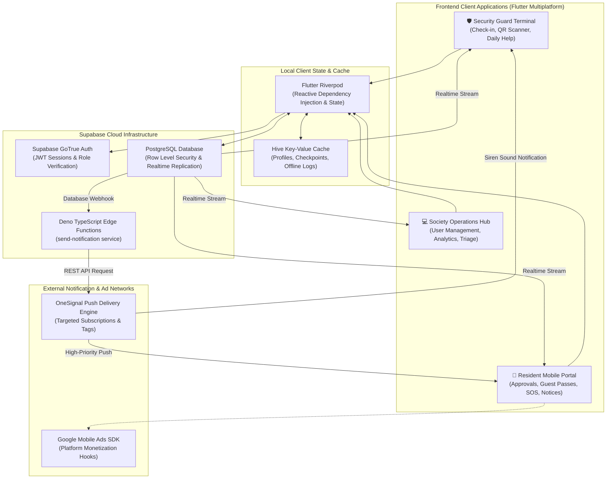
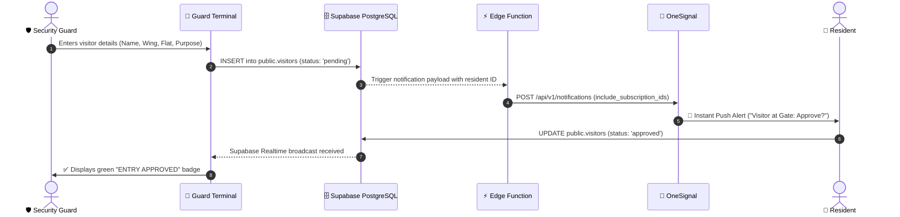
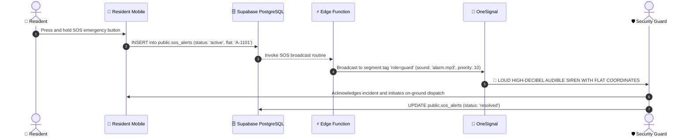

<div align="center">

# 🚪 ApnaGate
### *Smart Society Gatekeeper & Resident Security Management System*

[](https://flutter.dev)
[](https://dart.dev)
[](https://supabase.com)
[](https://onesignal.com)
[](https://riverpod.dev)
[](https://pub.dev/packages/hive_flutter)
[]()
[](LICENSE)

<br/>

**[🏛️ System Architecture](./docs/ARCHITECTURE.md)** &nbsp;•&nbsp;
**[🗄️ Database Setup](./database/README.md)** &nbsp;•&nbsp;
**[🔔 Operations Manual](./docs/QUICK_REFERENCE.md)** &nbsp;•&nbsp;
**[💰 Cost Analysis](./docs/COST_ANALYSIS.md)** &nbsp;•&nbsp;
**[🤝 Contributing](./docs/CONTRIBUTING.md)** &nbsp;•&nbsp;
**[🛡️ Security Policy](./docs/SECURITY.md)**

</div>

---

## 📖 Overview

**ApnaGate** is a smart building, apartment complex, and gated society security management platform engineered for real-time visitor gatekeeping, digital invitation passes, domestic help attendance tracking, and instant emergency alerts.

Residential complexes frequently rely on physical visitor register books and security intercom calls that are slow, lack auditability, and delay visitor entries. **ApnaGate** bridges security guards, residents, and society administrators into one synchronized real-time ecosystem powered by **Flutter**, **Supabase PostgreSQL with Row Level Security (RLS)**, and **OneSignal Push Notifications**.

### ✨ Key Capabilities

- 🔔 **Sub-Second Multi-Layer Push Notifications**: Instant visitor arrival alerts delivered directly to residents via OneSignal and Supabase Realtime webhooks.
- 🚨 **High-Priority Audible SOS Siren**: One-tap emergency broadcast dispatching loud audio alarms and exact apartment coordinates to on-duty security guards.
- 🛡️ **Zero-Friction Guard Gatekeeper Mode**: Lightning-fast check-in with flat lookups, digital QR pass scanning via `mobile_scanner`, and daily staff logging.
- 👥 **Resident Management Portal**: One-tap approval/denial of guests, visitor history logs, household member registries, and maintenance complaints.
- 🗄️ **Dual-Channel Offline Caching**: Embedded Hive local database (`user_cache`, `patrol_logs`) ensures seamless gate operations during intermittent network drops.
- 🔒 **Enterprise-Grade Data Isolation**: Strict PostgreSQL Row Level Security (RLS) policies with `WITH CHECK` validations enforce airtight tenant boundaries.
- 🧪 **Production Tested**: Comprehensive automated test suites (14/14 passing), strict static analysis (`0 issues`), and clean code architecture.

---

## 📑 Table of Contents

- [🏛️ System Architecture Diagram](#️-system-architecture-diagram)
- [⚡ Core Real-Time Workflows](#-core-real-time-workflows)
  - [1. Visitor Arrival & One-Tap Approval](#1-visitor-arrival--one-tap-approval)
  - [2. Emergency SOS Alarm Dispatch](#2-emergency-sos-alarm-dispatch)
- [👥 Specialized Experience & Roles Matrix](#-specialized-experience--roles-matrix)
- [📁 Clean Repository Directory Tree](#-clean-repository-directory-tree)
- [🛡️ Database & Row Level Security (RLS) Matrix](#️-database--row-level-security-rls-matrix)
- [💻 Technology Stack & Ecosystem](#-technology-stack--ecosystem)
- [🚀 Getting Started & Installation Guide](#-getting-started--installation-guide)
- [🧪 Automated Testing & Static Analysis](#-automated-testing--static-analysis)
- [📱 Production Build & Release](#-production-build--release)
- [🤝 Contributing, Security & License](#-contributing-security--license)

---

## 🏛️ System Architecture Diagram



---

## ⚡ Core Real-Time Workflows

### 1. Visitor Arrival & One-Tap Approval



---

### 2. Emergency SOS Alarm Dispatch



---

## 👥 Specialized Experience & Roles Matrix

The platform provides dedicated, role-gated interfaces designed for distinct operations:

| Capability / Feature | 🛡️ Security Guard | 👤 Society Resident | 👑 Society Admin |
| :--- | :---: | :---: | :---: |
| **Visitor Entry Logging** | ✅ Create & Dispatch | ❌ View Only | ✅ Full Audit |
| **One-Tap Visitor Approval** | ❌ Read Status | ✅ Approve / Deny | ✅ Full Audit |
| **QR Guest Pass Scanning** | ✅ Live Camera Scanner | ❌ (Creates Passes) | ✅ Verification Logs |
| **Digital Pass Generation** | ❌ | ✅ QR & 6-Digit Code | ✅ Administrative |
| **Emergency SOS Trigger** | ❌ (Receives Sirens) | ✅ Instant Broadcast | ✅ Receives Alerts |
| **Daily Staff (Maids/Cooks)** | ✅ Log Entry & Exit | ✅ Household Roster | ✅ Society Roster |
| **Security Patrol Logging** | ✅ Scan Checkpoints | ❌ | ✅ Checkpoint Logs |
| **Complaints & Maintenance** | ❌ | ✅ File & Track | ✅ Triage & Resolve |
| **Notice Board** | ✅ Read Notices | ✅ Read Notices | ✅ Create & Publish |
| **User & Tenant Management** | ❌ | ❌ (Own Family) | ✅ Full CRUD Profiles |
| **Analytics & Gate Metrics** | ❌ | ❌ | ✅ Volume & Reports |

---

## 📁 Clean Repository Directory Tree

```text
ApnaGate/
├── 📄 README.md                           # Main engineering documentation & setup guide
├── 📄 LICENSE                             # MIT Open Source License
│
├── 📁 app/                                # Flutter cross-platform mobile/desktop application
│   ├── 📄 pubspec.yaml                    # Flutter dependencies & asset declarations
│   ├── 📄 analysis_options.yaml           # Strict Dart analyzer rules (0 errors, 0 warnings)
│   ├── 📄 l10n.yaml                       # Localization generation manifest
│   ├── 📁 assets/                         # Application bundled static assets
│   │   ├── 📄 logo.png                    # High-resolution brand logo
│   │   └── 📁 sounds/
│   │       └── 📄 alarm.mp3               # High-decibel SOS emergency siren audio
│   ├── 📁 lib/
│   │   ├── 📄 main.dart                   # Application bootstrap, background config & error boundary
│   │   ├── 📄 app.dart                    # MaterialApp, dark/light theme binding & 26 named routes
│   │   ├── 📄 auth_wrapper.dart           # Role-based route guard & auth state consumer
│   │   ├── 📄 supabase_config.dart        # Production Supabase URL, anon key & OneSignal app ID
│   │   ├── 📁 models/                     # Strongly-typed domain models with JSON serialization
│   │   │   ├── 📄 user.dart               # AppUser model with roles, wing, flat & subscription ID
│   │   │   ├── 📄 visitor.dart            # Visitor entry model with timestamps & lifecycle states
│   │   │   ├── 📄 guest_pass.dart         # GuestPass model with QR code & expiration window
│   │   │   ├── 📄 daily_help.dart         # DailyHelp model (Maid, Cook, Driver, Housekeeping)
│   │   │   ├── 📄 notice.dart             # Notice model for society announcements
│   │   │   ├── 📄 complaint.dart          # Complaint & ComplaintChat ticket models
│   │   │   ├── 📄 sos_alert.dart          # SosAlert model with apartment coordinates
│   │   │   └── 📄 service_provider.dart   # ServiceProvider directory model
│   │   ├── 📁 services/                   # Business logic, state providers & cloud APIs
│   │   │   ├── 📄 auth_service.dart       # Supabase GoTrue Auth service & stream provider
│   │   │   ├── 📄 firestore_service.dart  # Data access layer with Hive offline caching
│   │   │   ├── 📄 onesignal_manager.dart  # OneSignal user login & subscription synchronization
│   │   │   ├── 📄 ads_service.dart        # Google Mobile Ads safe initializer
│   │   │   └── 📄 background_service.dart # Continuous background monitoring service
│   │   ├── 📁 utils/                      # Common design system & routing constants
│   │   │   ├── 📄 app_constants.dart      # Society wings, roles, statuses & cache box keys
│   │   │   ├── 📄 app_routes.dart         # Exhaustive registry of 26 application route identifiers
│   │   │   └── 📄 app_theme.dart          # Cyberpunk dark theme & clean light theme
│   │   ├── 📁 widgets/                    # Reusable atomic UI widgets
│   │   │   └── 📄 error_boundary.dart     # Production error boundary catching unhandled UI exceptions
│   │   └── 📁 screens/                    # View layer segmented by user role
│   │       ├── 📄 splash_screen.dart      # Animated startup splash screen
│   │       ├── 📁 auth/
│   │       │   └── 📄 login_screen.dart   # Email & password authentication with form validation
│   │       ├── 📁 guard/
│   │       │   ├── 📄 guard_home.dart     # Guard quick actions grid
│   │       │   ├── 📄 add_visitor.dart    # Visitor check-in form with instant notification dispatch
│   │       │   ├── 📄 scan_pass.dart      # Live camera QR scanner using mobile_scanner
│   │       │   ├── 📄 visitor_status.dart # Real-time visitor logs and status filters
│   │       │   ├── 📄 staff_entry.dart    # Domestic help check-in & check-out toggle
│   │       │   └── 📄 patrol_screen.dart  # Security patrol checkpoint verification
│   │       ├── 📁 resident/
│   │       │   ├── 📄 resident_home.dart  # Resident home dashboard with quick SOS banner
│   │       │   ├── 📄 approval_screen.dart# Pending visitor approval/denial cards
│   │       │   ├── 📄 visitor_history.dart# Filterable visitor entry history
│   │       │   ├── 📄 guest_pass_screen.dart # Digital invite generator
│   │       │   ├── 📄 my_pass.dart        # Active QR code invitation cards
│   │       │   ├── 📄 household_screen.dart# Family member management
│   │       │   ├── 📄 househelp_screen.dart# Assigned domestic staff directory
│   │       │   ├── 📄 notice_list.dart    # Official society notice board
│   │       │   ├── 📄 complaint_list.dart # Maintenance ticket submission & list
│   │       │   ├── 📄 service_directory.dart # Emergency technicians directory (Plumber, Electrician)
│   │       │   └── 📄 sos_screen.dart     # Emergency SOS button with confirmation
│   │       └── 📁 admin/
│   │           ├── 📄 admin_dashboard.dart# Society operations control center
│   │           ├── 📄 admin_extras.dart   # Complaint management & service provider admin
│   │           ├── 📄 user_management.dart# Resident, guard, and administrator directory
│   │           ├── 📄 notice_admin.dart   # Society-wide announcement publisher
│   │           ├── 📄 patrol_logs.dart    # Security patrol audit trail
│   │           └── 📄 analytics_dashboard.dart # Visitor volume and staff occupancy metrics
│   ├── 📁 test/                           # Automated test suites
│   │   ├── 📄 models_test.dart            # Unit tests for JSON serialization & copyWith
│   │   ├── 📄 theme_test.dart             # Theme brightness, color scheme & typography tests
│   │   ├── 📄 routes_test.dart            # Route registry uniqueness & formatting validation
│   │   ├── 📄 error_boundary_test.dart    # ErrorBoundary widget rendering tests
│   │   └── 📄 widget_test.dart            # Application smoke test
│   └── 📁 scripts/
│       └── 📄 build_optimized.sh          # Release APK build script with ABI splitting & obfuscation
│
├── 📁 database/                           # Database schemas & security policies
│   ├── 📄 README.md                       # Complete database setup & RLS policy documentation
│   └── 📄 MASTER_SETUP.sql                # Complete PostgreSQL schema, RLS policies & seed data
│
├── 📁 docs/                               # System documentation & technical reports
│   ├── 📄 ARCHITECTURE.md                 # Detailed architecture overview & sequence diagrams
│   ├── 📄 COST_ANALYSIS.md                # Lifecycle infrastructure cost breakdown & tiers
│   ├── 📄 QUICK_REFERENCE.md              # Operations manual & notification troubleshooting
│   ├── 📄 CONTRIBUTING.md                 # Contribution guidelines & PR checklist
│   └── 📄 SECURITY.md                     # Vulnerability reporting & security architecture
│
└── 📁 supabase/                           # Supabase configuration & Edge Functions
    ├── 📄 config.toml                     # Supabase CLI local development configuration
    └── 📁 functions/
        ├── 📄 deno.json                   # Deno runtime configuration
        └── 📁 send-notification/
            └── 📄 index.ts                # TypeScript Edge Function for OneSignal push dispatch
```

---

## 🛡️ Database & Row Level Security (RLS) Matrix

Every table in Supabase PostgreSQL enforces strict Row Level Security (RLS) with non-recursive security definer functions (`is_admin()`, `is_guard()`, `is_guard_or_admin()`):

| Database Table | Residents Permission | Security Guards Permission | Admins Permission |
| :--- | :--- | :--- | :--- |
| `profiles` | `SELECT` own; `UPDATE` own profile | `SELECT` flat & name directory | `ALL` (Full CRUD) |
| `visitors` | `SELECT`/`UPDATE` own flat's visitors | `ALL` (Check-in & update all entries) | `ALL` (Full CRUD) |
| `guest_passes` | `ALL` on own generated passes | `SELECT` during camera QR scan | `ALL` (Full CRUD) |
| `daily_help` | `ALL` on assigned household staff | `SELECT` & `UPDATE` is_inside status | `ALL` (Full CRUD) |
| `sos_alerts` | `INSERT` & `SELECT` own emergency alerts | `SELECT` & `UPDATE` active sirens | `ALL` (Full CRUD) |
| `notices` | `SELECT` (Read-only broadcast) | `SELECT` (Read-only broadcast) | `ALL` (Publish & Delete) |
| `complaints` | `ALL` on own filed complaints | None | `ALL` (Triage & Resolve) |
| `complaint_chats` | `SELECT`/`INSERT` on own complaints | None | `ALL` (Manage Chat) |
| `patrol_logs` | None | `INSERT` & `SELECT` own checkpoint logs | `SELECT` (Audit Logs) |
| `service_providers` | `SELECT` (Read-only directory) | `SELECT` (Read-only directory) | `ALL` (Manage Providers)|

---

## 💻 Technology Stack & Ecosystem

- **Frontend Framework:** [Flutter 3.47+](https://flutter.dev) (Dart 3.13+) targeting Android, iOS, and macOS.
- **State Management:** [Flutter Riverpod 2.6+](https://riverpod.dev) with reactive dependency injection.
- **Backend & Database:** [Supabase](https://supabase.com) (PostgreSQL 17 with Row Level Security, Auth & Realtime replication).
- **Push Notification Service:** [OneSignal](https://onesignal.com) (`onesignal_flutter 5.x`) with subscription IDs and fallback channels.
- **Local Embedded Storage:** [Hive](https://pub.dev/packages/hive_flutter) (`hive_flutter 1.1+`) for offline user profiles and patrol checkpoint persistence.
- **Hardware Integrations:**
  - `mobile_scanner`: High-performance hardware camera barcode & QR reader.
  - `qr_flutter`: Dynamic QR pass code rendering.
  - `local_auth`: Biometric authentication support.
  - `audioplayers`: Emergency high-decibel alarm playback.
  - `flutter_background_service`: Continuous background socket and event monitoring.
- **Edge Compute:** [Supabase Edge Functions](https://supabase.com/docs/guides/functions) written in TypeScript on Deno.

---

## 🚀 Getting Started & Installation Guide

### 1. Prerequisites
- [Flutter SDK](https://docs.flutter.dev/get-started/install) (`v3.10` or higher)
- [Dart SDK](https://dart.dev/get-dart) (`v3.0` or higher)
- A [Supabase](https://supabase.com) account and project
- A [OneSignal](https://onesignal.com) application

### 2. Clone Repository
```bash
git clone https://github.com/Coderaryanyadav/ApnaGate.git
cd ApnaGate
```

### 3. Database Initialization
1. Navigate to your [Supabase Project Dashboard](https://supabase.com/dashboard) -> **SQL Editor**.
2. Open [`database/MASTER_SETUP.sql`](database/MASTER_SETUP.sql).
3. Copy and run the entire script. It sets up all tables, security definer functions, RLS policies, and default seed accounts:
   - `aryanjyadav@gmail.com` (Resident, Wing A, Flat 1101)
   - `guardawing@gmail.com` (Guard, Wing A)
   - `crescentlandmark@gmail.com` (Admin, Wing A, Flat 101)

### 4. Configure Application Credentials
Verify credentials in [`app/lib/supabase_config.dart`](app/lib/supabase_config.dart):
```dart
class SupabaseConfig {
  static const String supabaseUrl = 'YOUR_SUPABASE_PROJECT_URL';
  static const String supabaseAnonKey = 'YOUR_SUPABASE_ANON_KEY';
  static const String oneSignalAppId = 'YOUR_ONESIGNAL_APP_ID';
}
```

### 5. Install Dependencies
```bash
cd app
flutter pub get
```

### 6. Run the Application
```bash
# Launch on connected mobile device or desktop
flutter run
```

---

## 🧪 Automated Testing & Static Analysis

The repository includes strict Dart static analysis and comprehensive automated unit and widget test suites:

```bash
# Run static analysis (Strict linting - 0 errors, 0 warnings)
cd app
flutter analyze

# Run full test suite (14/14 tests passing)
cd app
flutter test
```

### Automated Test Suite Coverage
- `test/models_test.dart`: Serialization, deserialization, and `copyWith` validation for `AppUser`, `Visitor`, `GuestPass`, `DailyHelp`, `Notice`, `Complaint`, `SosAlert`, and `ServiceProvider`.
- `test/theme_test.dart`: Dark and light theme properties, color schemes, and brightness checks.
- `test/routes_test.dart`: Route registry completeness, formatting, and uniqueness validation across all 26 named routes.
- `test/error_boundary_test.dart`: Error boundary child rendering and exception shielding.
- `test/widget_test.dart`: Root application widget smoke test.

---

## 📱 Production Build & Release

To build an optimized, obfuscated release APK with split ABI architectures:

```bash
cd app
bash scripts/build_optimized.sh
```

Optimized artifacts will be generated at:
- `app/build/app/outputs/flutter-apk/app-arm64-v8a-release.apk`
- `app/build/app/outputs/flutter-apk/app-armeabi-v7a-release.apk`
- `app/build/app/outputs/flutter-apk/app-x86_64-release.apk`

---

## 🤝 Contributing, Security & License

- **Contributing**: Please review the [Contributing Guidelines](docs/CONTRIBUTING.md) before submitting pull requests.
- **Security Policy**: To report security vulnerabilities, review our [Security Policy](docs/SECURITY.md).
- **License**: This project is open-source and licensed under the [MIT License](LICENSE).
