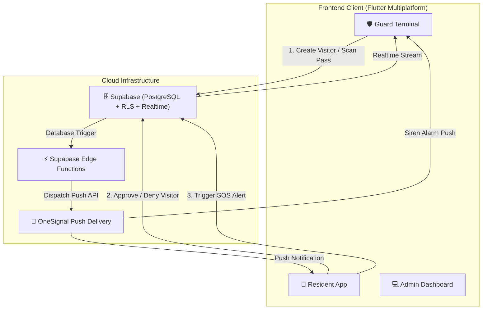
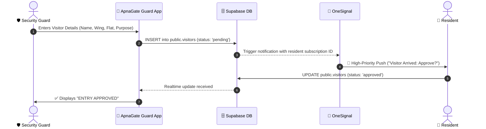
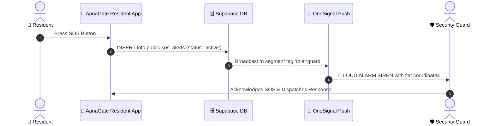

# 🏛️ ApnaGate System Architecture

---

## 🔄 Core Workflows

### 1. Visitor Arrival Notification Workflow

---

### 2. Emergency SOS Alert Workflow

---

## 💾 Offline Caching & Resilience

- **Local Storage:** Hive database (`user_cache`, `patrol_logs`) persists user profile and guard patrol checkpoints locally.
- **Background Synchronization:** Guard patrol logs are saved to Hive immediately and synchronized whenever network is active.
- **Dual-channel Delivery:** If OneSignal experiences delays, the app maintains an active Supabase Realtime channel while foregrounded or running through the background monitor service.
