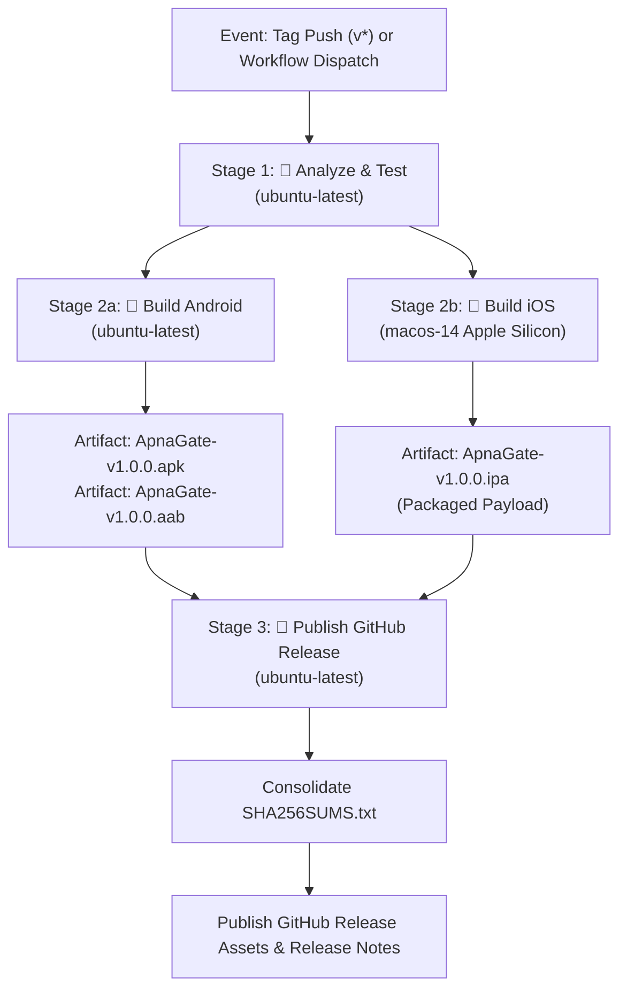

# 🏗️ Build, CI/CD & Release Documentation

This document provides complete instructions for building, packaging, verifying, and distributing **ApnaGate** for Android and iOS, both locally and through automated GitHub Actions cloud pipelines.

---

## 📋 Table of Contents

1. [Architecture & Target Matrix](#-architecture--target-matrix)
2. [Online CI/CD Workflow (GitHub Actions)](#-online-cicd-workflow-github-actions)
3. [Triggering Online Builds](#-triggering-online-builds)
4. [Local Build Instructions](#-local-build-instructions)
5. [Android Deployment & Installation Guide](#-android-deployment--installation-guide)
6. [iOS Sideloading & Installation Guide](#-ios-sideloading--installation-guide)
7. [Cryptographic Integrity Verification](#-cryptographic-integrity-verification)
8. [Release 1.0.0 Specification](#-release-100-specification)

---

## 🎯 Architecture & Target Matrix

| Platform | Target Artifact | Minimum OS | Delivery Method |
|---|---|---|---|
| **Android** | `ApnaGate-v<version>.apk` | Android 5.0 (API 21) | Universal APK, Direct Sideload, MDM |
| **Android** | `ApnaGate-v<version>.aab` | Android 5.0 (API 21) | Google Play Store Dynamic Delivery |
| **iOS** | `ApnaGate-v<version>.ipa` | iOS 15.5+ | AltStore, Sideloadly, TrollStore, Xcode |

---

## ☁️ Online CI/CD Workflow (GitHub Actions)

The cloud automation workflow is configured at [`.github/workflows/build-and-release.yml`](../.github/workflows/build-and-release.yml).

### Workflow Pipeline Stages:



### Stage Details:

1. **🧪 Analyze & Test**:
   - Environment: `ubuntu-latest`, OpenJDK 17, Flutter Stable.
   - Executes `flutter doctor -v`, `flutter pub get`, `flutter analyze`, and `flutter test --coverage`.
   - Gatekeeper: Any analysis warning or test failure halts the pipeline before build stages trigger.

2. **🤖 Build Android**:
   - Compiles release Universal APK (`flutter build apk --release`).
   - Compiles production App Bundle (`flutter build appbundle --release`).
   - Computes SHA-256 cryptographic hashes for generated binaries.
   - Uploads assets to workflow artifacts.

3. **🍎 Build iOS**:
   - Environment: `macos-14` (Apple Silicon runner with modern Xcode and CocoaPods).
   - Resolves CocoaPods dependencies (`pod install`).
   - Builds unsigned release binary (`flutter build ios --release --no-codesign`).
   - Packages `Runner.app` into distribution directory `Payload/` and zips into `ApnaGate-v<version>.ipa`.
   - Computes SHA-256 cryptographic hashes for generated IPA.

4. **🚀 Publish GitHub Release**:
   - Gathers all Android and iOS build artifacts.
   - Consolidates checksums into a single `SHA256SUMS.txt`.
   - Generates release notes and attaches all files to the official GitHub Release.

---

## ⚡ Triggering Online Builds

### Method 1: Push a Semantic Version Git Tag (Recommended)

Pushing any tag formatted as `v*` (e.g., `v1.0.0`) automatically starts the full pipeline, compiles APK and IPA, and publishes the GitHub Release:

```bash
git tag v1.0.0
git push origin v1.0.0
```

### Method 2: Manual Trigger via GitHub CLI (`gh`)

You can trigger a build and release on-demand from your terminal:

```bash
gh workflow run "Build & Release ApnaGate (APK & IPA)" \
  -f release_version="v1.0.0" \
  -f create_release=true
```

To monitor the workflow in real time:

```bash
gh run watch
```

### Method 3: GitHub Web UI
1. Navigate to `https://github.com/Coderaryanyadav/ApnaGate/actions`.
2. Select **Build & Release ApnaGate (APK & IPA)** from the left sidebar.
3. Click **Run workflow**, enter the version tag (e.g. `v1.0.0`), ensure **Publish GitHub Release** is checked, and click **Run workflow**.

---

## 💻 Local Build Instructions

### Prerequisites
- Flutter SDK `^3.10.0` (Recommended `3.47.x+`)
- Java Development Kit (JDK 17)
- Android SDK with platform tools & command line tools
- macOS with Xcode 15+ & CocoaPods (for iOS builds)

### 1. Static Analysis & Unit Tests
```bash
cd app
flutter pub get
flutter analyze
flutter test
```

### 2. Local Android Builds

```bash
# Build Release APK
cd app
flutter build apk --release

# Output path:
# app/build/app/outputs/flutter-apk/app-release.apk

# Build Release App Bundle (for Google Play Console)
flutter build appbundle --release

# Output path:
# app/build/app/outputs/bundle/release/app-release.aab
```

### 3. Local iOS Builds (macOS only)

```bash
cd app
flutter pub get
cd ios
pod install
cd ..

# Build unsigned release application
flutter build ios --release --no-codesign

# Package Runner.app into sideloadable IPA
mkdir -p dist-ios/Payload
cp -r build/ios/iphoneos/Runner.app dist-ios/Payload/
cd dist-ios
zip -r -9 ApnaGate-local.ipa Payload
rm -rf Payload
```

---

## 🤖 Android Deployment & Installation Guide

### Option A: Direct Device Installation (Browser / File Manager)
1. Download `ApnaGate-v1.0.0.apk` onto your Android smartphone or tablet.
2. Tap the downloaded file in your browser downloads or Files app.
3. When prompted, toggle **Allow from this source** in Settings.
4. Tap **Install** and launch ApnaGate.

### Option B: Command Line via ADB
```bash
adb devices
adb install -r ApnaGate-v1.0.0.apk
```

---

## 🍎 iOS Sideloading & Installation Guide

Because iOS non-App Store binaries require code signing against an Apple ID, use any of the following reliable sideloading utilities to sign and install `ApnaGate-v1.0.0.ipa`:

### Option 1: AltStore / SideStore (No Computer Needed after setup)
1. Install **AltStore** or **SideStore** on your iPhone/iPad.
2. Download `ApnaGate-v1.0.0.ipa` from the GitHub Release using Safari.
3. Open AltStore, tap the **My Apps** tab, tap `+` in the top corner, and select the downloaded IPA.
4. AltStore will sign the application with your free Apple ID and install it onto your home screen.

### Option 2: Sideloadly (macOS & Windows)
1. Download and open **Sideloadly** ([sideloadly.io](https://sideloadly.io/)).
2. Connect your iPhone to your computer via USB cable.
3. Drag `ApnaGate-v1.0.0.ipa` into Sideloadly.
4. Enter your Apple ID email.
5. Click **Start** to sign and push the app directly to your device.
6. On your iOS device, go to **Settings > General > VPN & Device Management**, tap your developer certificate, and select **Trust**.

### Option 3: TrollStore (iOS 14.0 - 16.6.1 / 17.0 on supported hardware)
1. Open the TrollStore application on your iOS device.
2. Import `ApnaGate-v1.0.0.ipa`.
3. Tap **Install**. The app installs permanently with full entitlements and no 7-day re-signing required.

### Option 4: Apple Developer CLI (`xcrun devicectl`)
```bash
xcrun devicectl device install app --device <YOUR_DEVICE_UDID> ApnaGate-v1.0.0.ipa
```

---

## 🔒 Cryptographic Integrity Verification

All releases provide a `SHA256SUMS.txt` manifest containing SHA-256 hashes for all distributed binaries. Verify that your downloaded files have not been corrupted or tampered with:

### On macOS / Linux:
```bash
# Check all files in the directory against the manifest
sha256sum -c SHA256SUMS.txt

# Or manually calculate the hash for a specific file:
shasum -a 256 ApnaGate-v1.0.0.apk
shasum -a 256 ApnaGate-v1.0.0.ipa
```

### On Windows (PowerShell):
```powershell
Get-FileHash -Algorithm SHA256 .\ApnaGate-v1.0.0.apk
Get-FileHash -Algorithm SHA256 .\ApnaGate-v1.0.0.ipa
```

---

## 🚀 Release 1.0.0 Specification

- **Release Tag**: `v1.0.0`
- **Application Bundle ID / Namespace**: `com.antigravity.apnagate.app`
- **Flutter Framework Target**: `3.47.x` (Channel: `stable`)
- **Android Compile SDK**: `35`
- **Android Min SDK**: `21` (Android 5.0 Lollipop)
- **iOS Deployment Target**: `15.5`
- **Backend Architecture**: Supabase (PostgreSQL 15 + Edge Functions + Realtime WebSockets)
- **State Management**: Flutter Riverpod 2.6.x + Code Generation
- **Local Persistence**: Hive 2.2.x Offline Box
